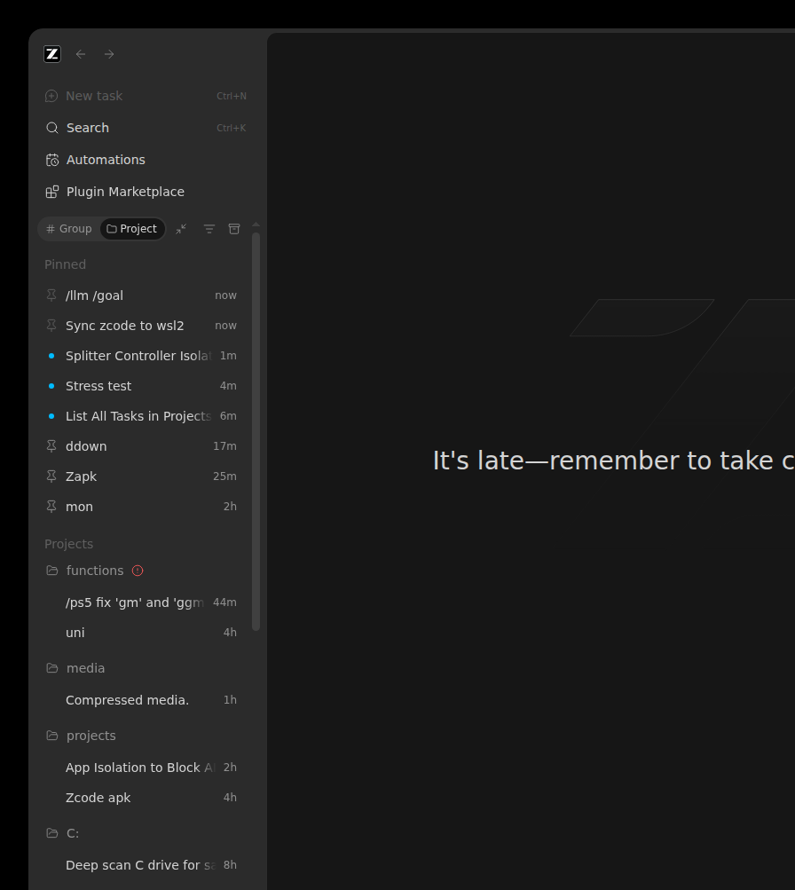

# ZCode WSL2 Persistence Engine

[](#requirements)
[-green)](#what-it-does)
[-black)](#zero_heartbeat-windows-side)
[-orange)](#safety-model)
[-success)](#credential-adoption-the-hard-part)

**One command turns a Windows ZCode Desktop installation into a fully independent,
always-resurrecting Linux GUI running in WSL2 — same account, same sessions, zero clicks,
zero terminal flashes, ever.**



*The window above is the official Linux ZCode Desktop app, rendered by WSLg onto the
Windows desktop, restored signed-in with the full session history after a simulated
reboot (WSL distro terminated, then silently self-recovered).*

---

## What it does

| Mission requirement | How it is met |
|---|---|
| **Desktop GUI, not CLI** | Installs the official `ZCode-x.y.z-linux-x64.deb` from `cdn-zcode.z.ai`; the Electron app renders natively through WSLg (`DISPLAY=:0`, `WAYLAND_DISPLAY=wayland-0`). Windows shows it as `msrdc → "ZCode (Ubuntu)"`. |
| **Zero terminal pop-ups on boot** | The Windows logon trigger runs `wscript.exe` (GUI subsystem) with `WshShell.Run(..., 0 /*hidden*/, false)`. `wsl.exe` never surfaces a window; inside WSL, cron `@reboot` and tmux are silent. Nothing ever flashes. |
| **Complete isolation from Windows** | One-way sync into the Linux filesystem (`rsync -av --update --ignore-existing`, never `--delete`, never writes to `/mnt/*`). After adoption the Linux store is authoritative: proven by a mount-namespace drill that genuinely unmounts `/mnt/c` + `/mnt/f` — state, binary, libraries and credential store remain fully operational. |
| **Never disturbs the Windows ZCode** | The source tree is read-only input. No locks, kills, writes, or deletions ever touch `C:\Users\Admin\.zcode` or the running Windows app. |
| **Ubuntu 24.04 (Noble) t64 packages** | Installs `libgtk-3-0t64`, `libasound2t64`, `libnss3`, `libnotify4`, `libxss1`, `libgbm1`, `x11-utils` and verifies `ldd` reports **zero** unresolved libraries. |
| **Persistence & auto-resumption** | The GUI lives inside a managed tmux session named `zcode`; user crontab has `@reboot` (boot hook) + a daily non-destructive sync; a hidden Windows **scheduled task at logon** fires the same boot path. Kill the app, the session, tmux, or the whole distro — the engine brings it all back. |
| **Already connected at launch** | The credential store is decrypted and **re-wrapped across the OS boundary** (see below), so the app restores its OAuth session automatically: `restoreCachedSession restored: zai <account>` in the logs, signed-in UI on screen. |

## Safety model

* **Never `--delete`.** Nothing on either side is ever removed by sync.
* **Never writes to `/mnt/*`.** The Windows tree is read-only input.
* **Linux-authoritative after adoption.** Files created/rewritten by the running Linux
  app (token refreshes, new sessions) are never clobbered: `--ignore-existing` for the
  bulk tree, newer-wins (`--update`) for settings, and the credential store is excluded
  from raw syncing entirely once adopted.
* **Single-instance guarantees.** A directory-atomic boot lock (never an flock'd fd —
  the tmux server would inherit it) plus stale-holder detection keep exactly one tmux
  session and one GUI process, no matter how many boot hooks race.
* **Orphan reaping** matches the Electron main process (which renames itself to
  comm `ZCode`), helpers, crashpad and host runtimes — for the WSL user only.

## Credential adoption (the hard part)

The desktop app encrypts `~/.zcode/v2/credentials.json` values as
`enc:v1:<iv>.<tag>.<ciphertext>` (AES-256-GCM, key = `sha256(secret)`), where the
secret defaults to `zcode-credential-fallback:<platform>:<homedir>:<username>` —
**different on Windows and Linux**, which is why a naive copy shows the
"Welcome / Connect your account" wall (decrypt fails: 密钥不匹配).

[migrate_credentials.py](wsl/migrate_credentials.py) solves it:

1. Brute-forces the exact Windows seed from a small candidate space (the GCM auth tag
   makes a correct guess self-verifying),
2. decrypts every value,
3. re-encrypts under a **fixed random secret** generated at
   `~/.zcode-wsl-auth-secret` (0600, never committed, never printed), and
4. `launch_zcode.sh` exports that secret as `ZCODE_CREDENTIAL_SECRET` — an app-supported
   override — so every launch decrypts the store.

The Windows original is kept as a staging copy (`credentials.windows.json`); the live
Linux store is never overwritten by sync after adoption.

## Requirements

* Windows 10/11 with **WSL2** and an **Ubuntu 24.04 (Noble)** distro (any name; scripts
  assume `Ubuntu`)
* WSLg (built into Windows 11 / WSL ≥ 1.0)
* The ZCode Desktop app installed on Windows (for the one-time state migration)
* ~6 GB free in the WSL VM (the `.zcode` state + app)

## Install — one command, fully idempotent

Everything in one shot, inside the Ubuntu distro:

```bash
sudo bash /mnt/f/study/Platforms/linux/wsl2/Applications/Desktop/Persistence/Engine/zcode-wsl-persistence/wsl/install.sh
```

`install.sh` is **check-then-skip everywhere**: every step (apt packages, cron,
user, the `.deb`, the 2.5 GB state sync, credential adoption, crontab) is
installed only if missing — anything already present is skipped. If everything
is already in place, the whole run takes **about a second**, never restarts a
healthy app, and just makes sure ZCode is **open and connected**. Anything
missing is installed — no exceptions — and then the app is opened.

Then, on **Windows** (PowerShell 5.1), register the silent logon trigger:

```powershell
powershell -NoProfile -ExecutionPolicy Bypass -File windows\Install-SilentBoot.ps1
```

That's all. Log off/on (or run `wsl -t Ubuntu` and let the task fire) and the
ZCode GUI appears, signed in, with your sessions.

### Always current, always resuming

* A cron **live mirror** (`*/20 * * * *`, seconds-fast) keeps the connection
  state and settings in step with the Windows installation, so the session
  list you see is current — sessions active on the Windows side show up in the
  WSL app marked live, ready to use.
* The app restores the **last workspace and its sessions automatically**
  (`lastWorkspaceSession` is part of the synced settings bundle): if the
  machine, WSL, or a session was closed mid-work, rerunning
  `install.sh` — or simply the next boot — reopens exactly where you left
  off. No per-session commands, nothing manual.

### Download

Grab a ready-to-run copy from the
[Releases page](https://github.com/Michaelunkai/zcode-wsl-persistence/releases)
(`zcode-wsl-persistence.zip` — contains everything above; no build step needed).

## Usage

| I want to… | Do this |
|---|---|
| See the app | It opens by itself at logon. Window title on Windows: **ZCode (Ubuntu)**. |
| Watch it from inside | `wsl -d Ubuntu -u ubuntu`, then `tmux attach-session -t zcode` (detach: `Ctrl-b d`) |
| Resync from Windows manually | `~/zcode-wsl-migration/sync_zcode.sh` |
| Verify everything | `bash ~/zcode-wsl-migration/verify.sh` (24 assertions, exit 0 = all good) |
| Prove isolation | `sudo bash tests/isolation-proof.sh` |
| Simulate a reboot | `tests/persistence-drill.sh` (from Windows Git Bash) |
| Remove the Windows trigger | `powershell -File windows\Uninstall-SilentBoot.ps1` |

## What "verified" means here (obsessive test battery)

* `verify.sh` — 25 assertions: binary, zero unresolved libs, all six t64 packages,
  cron active, `@reboot` + 20-min live mirror + daily entries, **no `--delete` anywhere**,
  2.5 GB migrated state 100% owned by `ubuntu`, credential store adopted (8 entries),
  OAuth session restored with **zero decrypt failures**, tmux session alive with the
  GUI under it, X server reachable, live X11 connections into WSLg, zero open regular
  files under `/mnt/*`, writable sentinel. **Result: 25 passed, 0 failed.**
* `tests/isolation-proof.sh` — live handle audit (no data dependency on `/mnt`),
  **mount-namespace deletion simulation** (unmounts `/mnt/c` + `/mnt/f` in a private
  namespace: 18k files readable, binary + libs clean, credential store decryptable),
  and a copy-and-delete drill. **Result: 3 passed, 0 failed.**
* `tests/persistence-drill.sh` — terminates the Ubuntu distro, fires the exact hidden
  logon path (`wscript` → VBS → wsl.exe), and watches the engine self-recover:
  one tmux session, GUI live in ~40 s, `msrdc "ZCode (Ubuntu)"` back on the desktop,
  account session restored. **Passed repeatedly.**
* `tests/Parse-Gate.ps1` — PowerShell 5.1 syntax gate for all Windows scripts.

## Troubleshooting

| Symptom | Cause / fix |
|---|---|
| "Welcome to ZCode — Connect your account" wall | Credential store not adopted. Re-run the PHASE 3b block of `install.sh` (idempotent). |
| Blank window | Old process still holding stale state. `pkill -9 -x ZCode` inside WSL, then run `~/zcode-wsl-migration/boot_zcode.sh`. |
| Two windows / duplicate sessions | Should be impossible (boot lock); check `~/zcode-wsl-migration/logs/boot.log` for the arbitration lines. |
| No window after reboot | `wsl -d Ubuntu -u ubuntu -- tmux ls` empty → cron isn't running: `sudo service cron start`. Check the Windows task fired: `Get-ScheduledTaskInfo ZCodeWslSilentBoot`. |
| Sync log shows `rc=23` | A live Windows file changed during read; the next daily cycle retries. Auth-critical files get 3 immediate retries. |

## Layout

```
├── wsl/                        everything that runs inside Ubuntu
│   ├── install.sh              one-shot provisioner (phases 1–5)
│   ├── launch_zcode.sh         GUI launcher (tmux pane command)
│   ├── boot_zcode.sh           idempotent boot hook (cron @reboot + hidden task)
│   ├── sync_zcode.sh           non-destructive sync engine (+ auth-bundle staging)
│   ├── migrate_credentials.py  cross-OS credential re-wrap (AES-256-GCM)
│   ├── verify.sh               24-assertion verification gate
│   └── zcode-sync.crontab      user crontab (@reboot + daily)
├── windows/                    everything that runs on Windows (all silent)
│   ├── Install-SilentBoot.ps1  registers the hidden logon task
│   ├── Uninstall-SilentBoot.ps1
│   ├── zcode-wsl-silent-boot.vbs  flash-free launcher (wscript, hidden)
│   └── zcode-wsl-boot.ps1      hidden PowerShell alternative body
├── tests/                      the obsessive battery + GUI proof capture
├── docs/screenshots/           signed-in proof
└── logs/                       run transcripts (gitignored)
```

## License

MIT — see [LICENSE](LICENSE).
